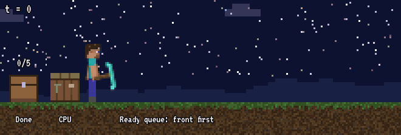
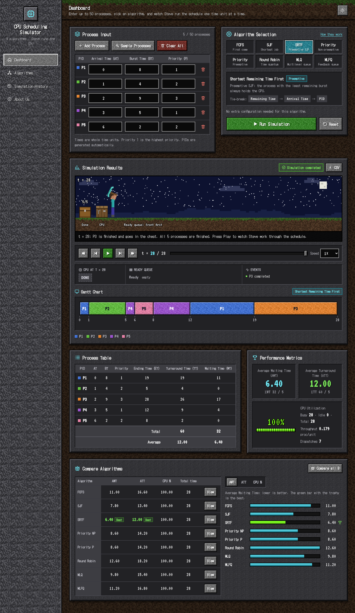
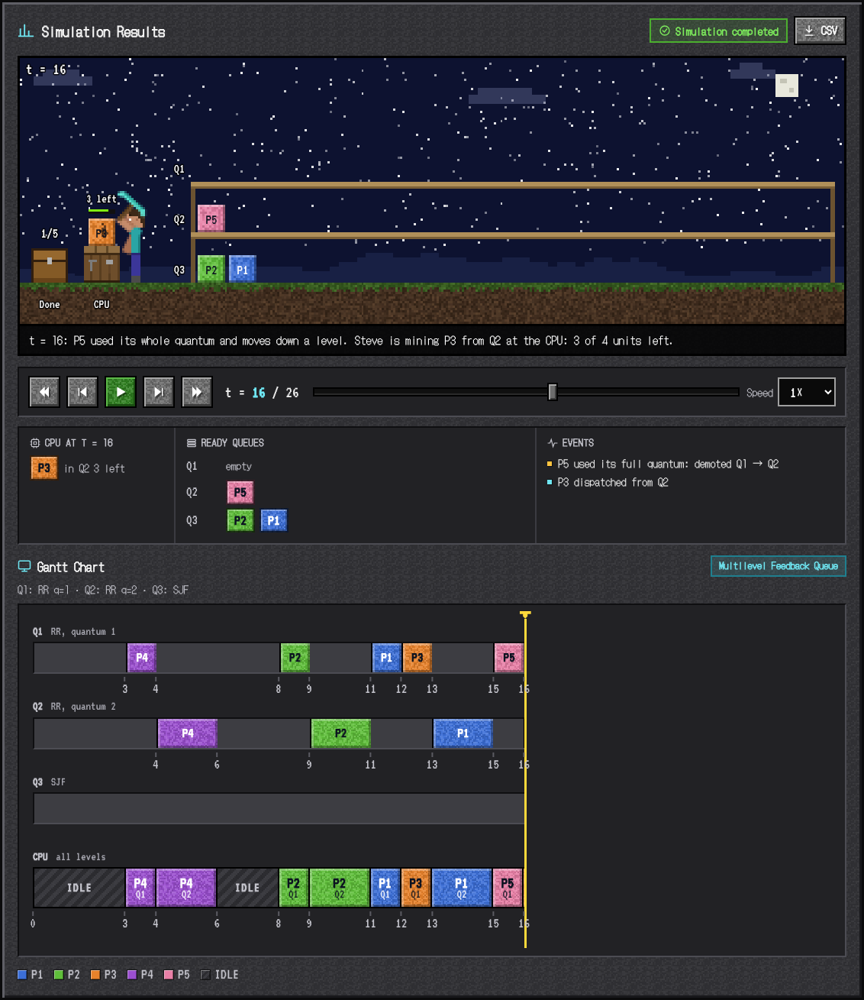
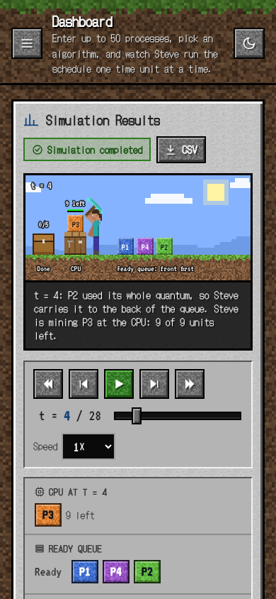

# CPU Scheduling Simulator

An interactive website that simulates and compares eight CPU scheduling algorithms: FCFS, SJF,
SRTF, Non-preemptive Priority, Preemptive Priority, Round Robin, Multilevel Queue and
Multilevel Feedback Queue. It includes a step-by-step Gantt chart, per-process results,
performance metrics, an algorithm comparison, CSV export, and simulation history
stored in MySQL.

The interface uses a blocky, Minecraft-style theme, and an animated scene acts out every
schedule: **Steve is the CPU**. Each process is a block waiting in the ready queue. When a process
is dispatched, Steve walks over, carries its block to the workbench and mines it one time unit at a
time. When a quantum runs out or a process is preempted, he carries the block back to its queue;
finished blocks break and drop into the chest.



Built with plain **HTML / CSS / JavaScript** (ES modules) and a small **PHP + MySQL** API for history.



| Step-through of the course's MLFQ Example 2, paused at t = 16 | Phone layout (390 px), Day theme |
|---|---|
|  |  |

These are real captures of the running app, taken on 2026-11-25. The design rules are in [DESIGN.md](DESIGN.md).

## Requirements

- **XAMPP** (PHP 8 + MySQL/MariaDB), installed at `C:\xampp`
- **Node.js 18+**, only for running the automated tests

## Run it

The project lives in `C:\xampp\htdocs\cpu-sim-minecraft`.

1. Open the **XAMPP Control Panel** and start **Apache** and **MySQL**.
2. Open <http://localhost/cpu-sim-minecraft/>.

**Without Apache:** start only MySQL, double-click `start-server.bat` (it uses XAMPP's PHP),
then open <http://localhost:8080>.

On the first request, the API creates the `cpu_scheduler` database and its
`simulation_history` table automatically. The schema is also in `database/schema.sql`.
Connection settings are in `api/config.php` (default: `root` with an empty password, as in XAMPP).
You can also set the `CPU_SIM_DB_HOST`, `_PORT`, `_NAME`, `_USER` and `_PASS` environment variables.

If MySQL is not running, the site still works and saves history in the browser instead.
The History page shows which storage is in use.

> The page uses ES modules, so it must be served over HTTP. Opening `index.html` directly
> from disk (`file://`) will not work.

## Tests

```bash
npm test
```

This runs Node's built-in test runner. Nothing needs to be installed. There are 40 tests in two files:

- `tests/algorithms.test.js` has hand-verified schedules for every algorithm. Each test checks
  the exact Gantt chart, Ending Time (ET), TT, WT, AWT, ATT and CPU
  utilization. The cases include different and identical arrival times, identical burst
  times, identical priority, identical arrival and burst, preemption, idle CPU before and
  between arrivals, very long bursts, RR with quanta 2, 3 and 100, the RR arrival-vs-requeue
  tie, MLQ inter-queue preemption and custom queue priorities, MLFQ demotion and
  uninterrupted time slices, completions on a shared boundary, input validation, and 25 processes.
- `tests/invariants.test.js` runs every algorithm on 300 generated workloads and checks:
  - each process executes exactly its burst, never before it arrives
  - the CPU is never idle while work is waiting
  - the timeline is contiguous from 0
  - the formulas and CPU utilization are correct
  - non-preemptive algorithms run each process in one block
  - each dispatch obeys the tie-break order, checked independently of the engine
  - Round Robin matches a separate reference implementation

## Project layout

```
index.html              Single-page app (Dashboard, Algorithms, History, About)
css/styles.css          Design tokens (Night default + Day theme), blocky components, responsive layout
js/engine/core.js       Scheduling engine: one time loop, pluggable queue disciplines (no DOM)
js/engine/algorithms.js The 8 algorithms as engine configurations, validation, defaults
js/engine/metrics.js    TT / WT / ET and aggregate metrics
js/app.js               UI controller (inputs, playback, results, compare, history, CSV)
js/ui/scene.js          The animated "Steve runs the CPU" scene (canvas, driven by the engine trace)
js/ui/textures.js       Procedural pixel textures (dirt, grass, deepslate, speckle) exposed as CSS variables
js/ui/*.js              Gantt rendering, icons, history client, static pages
api/history.php         REST endpoint: GET list, POST save, DELETE one or all
api/db.php, config.php  PDO connection and settings; creates the DB and table if missing
database/schema.sql     MySQL schema
tests/                  Automated engine tests
docs/ALGORITHMS.md      Exact rules and tie-breaking for every algorithm
```

## Using the simulator

- **Process Input:** add, edit or delete processes (up to 50). PIDs are generated
  automatically. Invalid cells show an error under the field, and Run shows a linked error summary.
- **Algorithm Selection:** choose one of the 8 algorithms. Round Robin shows the Time
  Quantum. MLQ shows the queues (queue priority, algorithm, quantum) and adds a Queue column
  to the process table. MLFQ shows its levels and quanta, and the last level's algorithm.
- **Run Simulation** draws the Gantt chart, results table and metrics. Use the playback bar
  (step back or forward, play/pause, speed, scrubber) to watch the CPU, ready queues and
  events change at each time unit.
- **The scene** above the playback bar follows the same playback. Play and Step forward animate
  Steve; the other controls jump straight to that time. The caption under the scene says in words
  what is happening. Multilevel algorithms show one shelf per queue (Q1 on top). One step lasts
  1.2 seconds at 1× so Steve has time to walk; use the Speed menu to go faster. With
  "reduce motion" turned on in the operating system, the scene shows still frames instead.
- The sun/moon button switches between the Night (dark) and Day (light) themes.
- **Sound:** the note button turns the background music on and off, and the speaker button
  does the same for the sound effects (pickaxe hits, blocks breaking, the chest, footsteps).
  The effects are generated in code. The music plays C418's "Sweden" and "Mice on Venus" in random
  order, but the music files are not included: copy your own `sweden.mp3` and `mice-on-venus.mp3`
  into the `music/` folder (see [music/README.md](music/README.md)). Sound starts after your first click.
- If any input changes after a run, the results are marked **Outdated** and dimmed until you run again.
- **Compare all 8** runs every algorithm on the same processes and marks the best value for each metric.
- **CSV** exports the results table, metrics and Gantt segments.
- **About Us:** add, edit, reorder and delete the development team members. Each member has
  a name, role, short description and profile picture. Pictures are cropped to a square and
  resized in the browser, then stored in MySQL in the `team_members` table through `api/members.php`.

See [docs/ALGORITHMS.md](docs/ALGORITHMS.md) for the scheduling rules.
